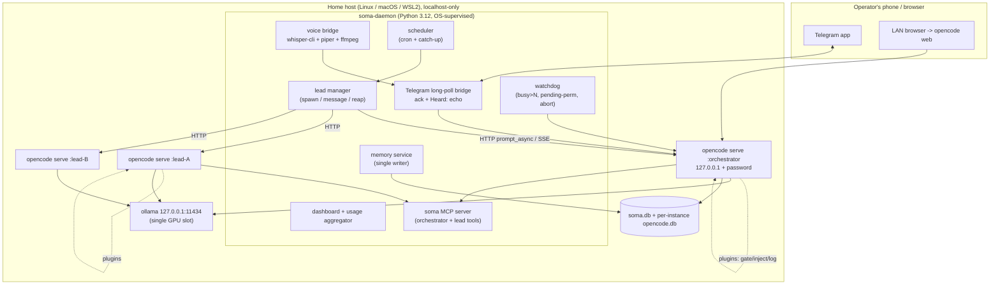
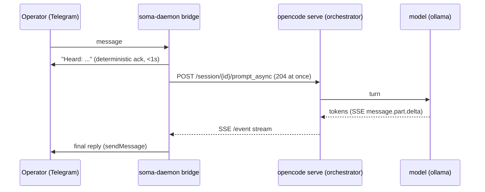
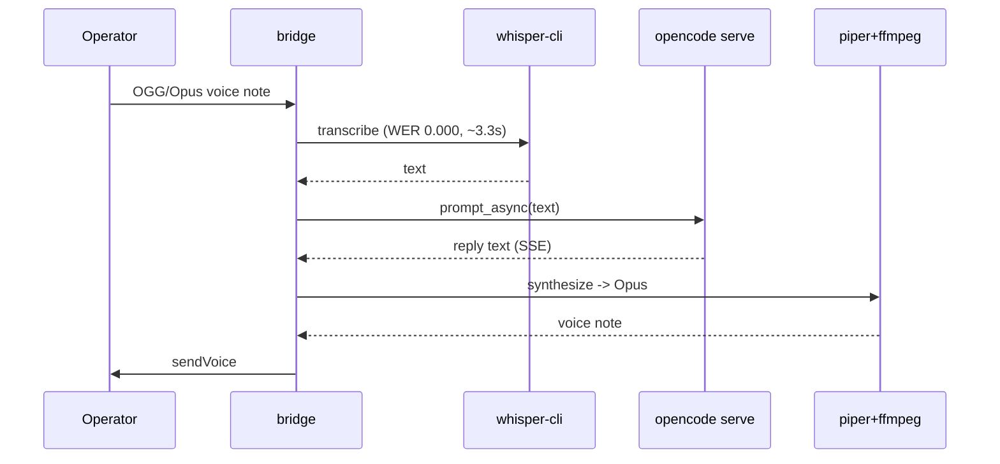
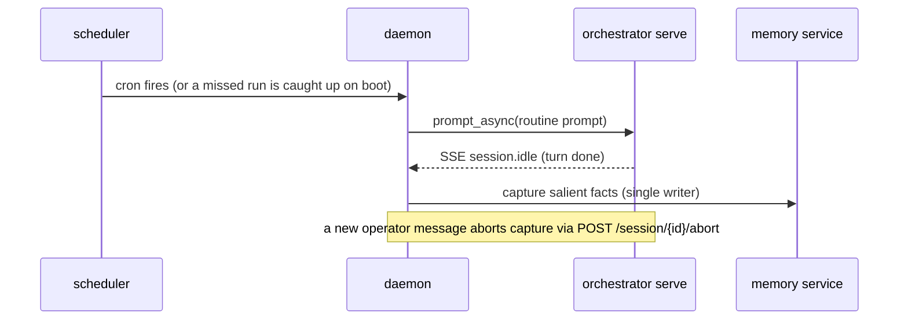

# opencode-soma Architecture

How a soma-style assistant is rebuilt with opencode 1.18.8 as the engine, a local model, and no VPS.
Grounded in the probe evidence under `evidence/opencode/` and the design decisions below.

## Goals and constraints

- No VPS, no hosted account: runs on the operator's own Linux box, Mac, or Windows+WSL2.
- Any model: a local ollama model by default, any opencode-supported provider if the operator wants.
- Home NAT, localhost-first: every server binds 127.0.0.1; remote access is the operator's choice.
- **One writer per opencode data dir.** This is the load-bearing runtime rule, forced by the P1
  evidence: a second process writing a session a `serve` already owns wedges it
  (`evidence/opencode/P1-headless/busy.log`, `evidence/opencode/P1-headless/run1/wedge-snapshot.log`).
  So each lead is exactly one long-lived `opencode serve` with its own XDG dirs, and the daemon is
  the only HTTP client.

## Components



- **soma-daemon** (the product; the OS supervises it): the Telegram long-poll bridge (deterministic
  ack + a "Heard: ..." echo before the model runs); the voice bridge (whisper-cli in, piper+ffmpeg
  out, both proven at WER 0.000 in `evidence/platform/stt-whisper.log` / `evidence/platform/tts-piper.log`);
  the lead manager; the event bus (the `soma_report` analog); the scheduler with catch-up; the
  single-writer memory service; the dashboard; the usage aggregator; and a watchdog that, on a lead
  stuck busy beyond N minutes or a pending permission, replies or aborts over HTTP.
- **Orchestrator `opencode serve` + N lead serves**: each binds 127.0.0.1 on a random port with a
  random password, its own XDG dirs, `autoupdate:false`, `share:disabled`. The daemon is the only
  HTTP client — the P3 finding (a caller can re-grant a tool per request) makes the server password
  the trust boundary (`evidence/opencode/P3-mcp/scoping-verdict.log`).
- **Plugins** on every serve: `gate` (`tool.execute.before`), `inject` (`chat.message` +
  `experimental.chat.system.transform`), `activity` (`tool.execute.after`) — all proven in P2.
- **MCP**: a daemon-hosted `soma` server (orchestrator tools: spawn/message/list leads, schedule,
  memory, reply; lead tools: report, memory, scoped) plus playwright. Leads are not offered the
  telegram/admin tools — per-agent scoping holds against the model (P3).

## Data stores

| Store | Owner | Holds |
|---|---|---|
| `soma.db` (SQLite) | daemon (single writer) | lead registry, events, schedules, memory, usage snapshots |
| per-instance `opencode.db` | each `opencode serve` | that instance's sessions, messages, parts (crash-durable, P1) |
| `activity.jsonl` | activity plugin | one line per tool call (tool, args, session, parent, agent, ms) |
| browser profile dir | playwright | persistent social logins (`evidence/platform/playwright-persist.log`) |
| `secrets.env` (0600) | daemon | bot token, server passwords, provider keys |

## Isolation per OS

- **Linux**: `systemd --user` units + lingering; each lead launched via
  `systemd-run --user --scope -p MemoryMax=...` for a memory cap.
- **macOS**: a LaunchAgent for the daemon; leads are child processes (no cgroup memory cap — a known
  gap); the installer sets the power/sleep expectations.
- **Windows**: WSL2 plus a keep-alive, desk-verified only (see PLATFORM-MATRIX.md).

## Flows

Text DM, instant ack then stream:



Voice DM:



Spawn a lead and message it:

```mermaid
sequenceDiagram
  participant D as soma-daemon (lead manager)
  participant L as opencode serve (new lead, own data dir)
  D->>L: start serve (127.0.0.1, random port+password)
  D->>L: POST /session {title, agent: lead}
  D->>L: prompt_async("read BRIEF.md, begin")
  Note over D,L: daemon is the ONLY HTTP client for this serve
  L-->>D: SSE events; status via GET /session/status
```

Lead needs operator input, then is answered:

```mermaid
sequenceDiagram
  participant L as lead serve
  participant D as soma-daemon
  participant U as Operator
  L-->>D: SSE permission.asked (or soma MCP ask tool)
  D->>U: Telegram: "lead-A asks: run X? [yes/no]"
  U->>D: "yes"
  D->>L: POST /permission/{id}/reply {reply: once}
  Note over L: tool runs; proven in evidence/opencode/P6-permissions/reject-retest.log
```

Scheduled routine with catch-up, and memory capture at idle:



## Mapping: every claude-soma component -> opencode-soma component

| claude-soma | opencode-soma | Note / evidence |
|---|---|---|
| bot session (Claude Code) | orchestrator `opencode serve` + daemon bridge | `evidence/opencode/P8-serve/serve.log` |
| project-orchestrator MCP `src/claude_soma/mcp_servers/project_orchestrator/server.py:193-230` | soma MCP (HTTP spawn/message, no tmux) | `evidence/opencode/P4-subagents/basic.log` |
| hermes-notify event bus | soma MCP `report` tool + `soma.db` events | design |
| notify_inject.sh `scripts/notify_inject.sh:1-167` | inject plugin (chat.message + system.transform) | `evidence/opencode/P2-hooks/inject.log` |
| orchestrator_gate.py `scripts/orchestrator_gate.py:41-63` | gate plugin (tool.execute.before, parentID lookup) | `evidence/opencode/P2-hooks/gate.log`, `evidence/opencode/P2-hooks/extras.log` |
| log_activity.sh `scripts/log_activity.sh:1-40` | activity plugin (tool.execute.after) | `evidence/opencode/P2-hooks/activity.log` |
| tg_reply_guard | bridge auto-forward of the final assistant text | design |
| heard_gate | deterministic "Heard:" echo in the bridge | design |
| systemd timers `src/claude_soma/platform/services.py:1-555` | daemon scheduler with catch-up | NEEDS-BUILD |
| Caddy + OAuth dashboard `src/claude_soma/install.py:578-581` | localhost dashboard + LAN `opencode web` | `evidence/opencode/P8-serve/web-index.html` |
| VNC headed browser | headed playwright under the daemon | `evidence/platform/playwright-persist.log` |
| Remote Control (hosted relay) | `opencode web`/`attach` on the LAN (+ user tunnel) | `evidence/opencode/P8-serve/serve.log` |
| sudo systemd-run (root) | user-level `systemd --user` / LaunchAgent | `evidence/platform/linux-container.log` |

## Install wizard: `opencode-soma init`

- **DETECTS**: OS/arch/WSL; opencode present and version vs the pin (1.18.8); ollama reachable with
  the model pulled and its real context length (`evidence/opencode/P0-setup/sandbox-verify.log`);
  whisper-cli / ffmpeg / piper; free loopback ports; an existing install.
- **ASKS**: bot token (verified with getMe); operator chat id via a one-message pairing; model /
  provider; data dir; voice on/off; dashboard-on-LAN on/off.
- **WRITES**: `~/.opencode-soma/` config + secrets 0600; one `opencode.json` per instance; a
  user-level service unit / LaunchAgent.
- **REFUSES**: running as root; an unpinned or wrong-version opencode; a non-loopback `serve` bind;
  a LAN dashboard without pairing; a bot token that already has a webhook set; a second poller when
  a lock is held; native Windows (WSL2 only); and touching the operator's own `~/.config/opencode/`.
