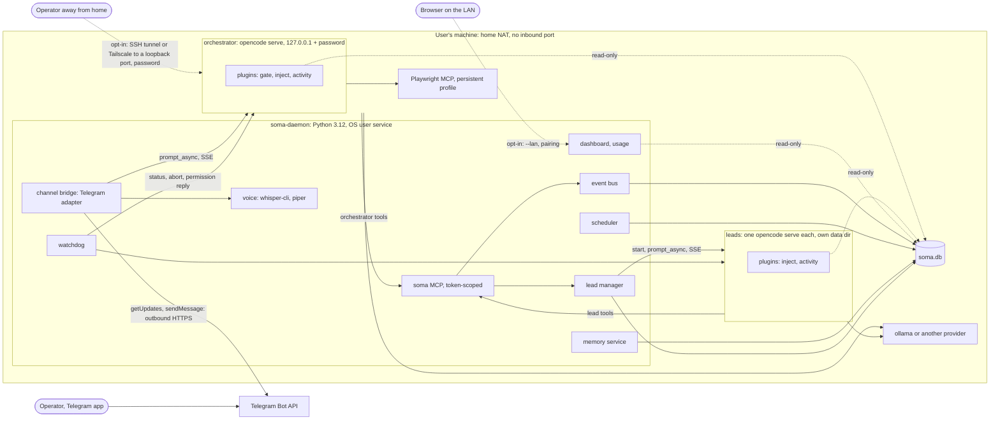
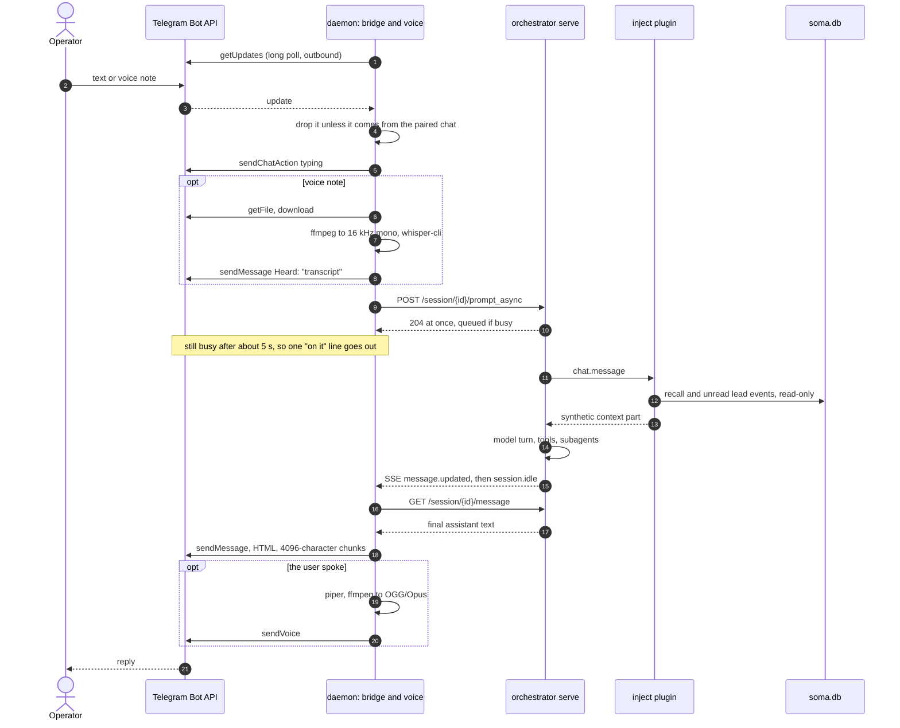
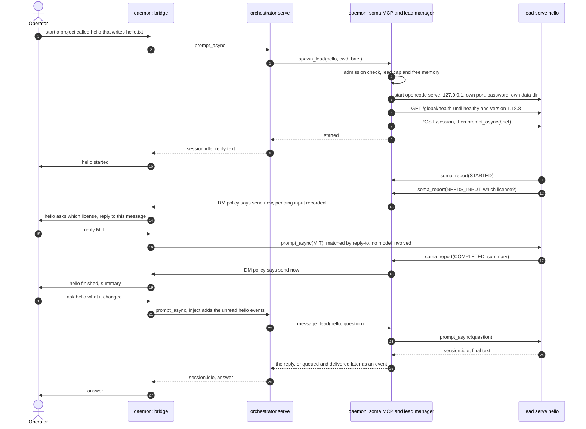
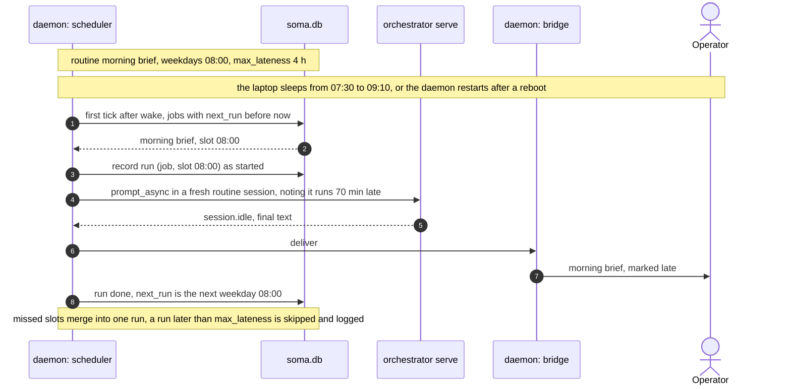
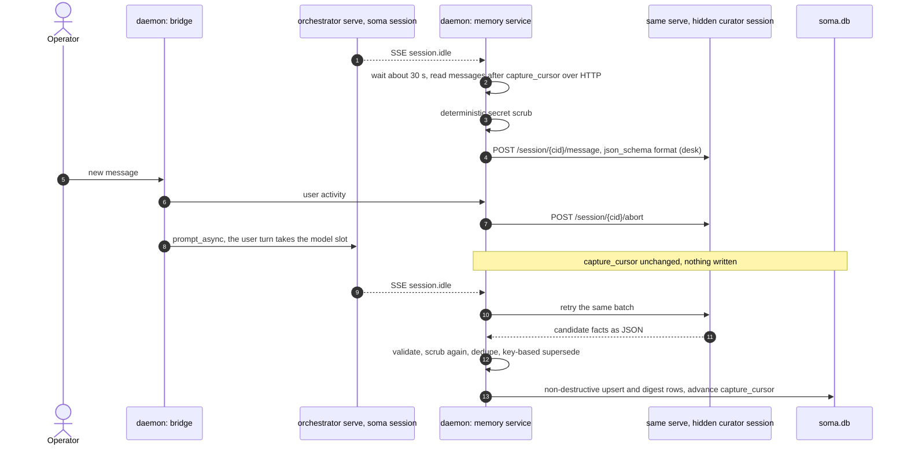

# opencode-soma architecture

How opencode-soma is built: which processes run, what each one owns, where data lives, how a
message moves through the system, and what keeps it safe and running on a home machine. It turns the
research into the design that ROADMAP.md's phases P0 to P6 build.

Conventions:

- Paths are under `research/opencode-soma/` unless they carry a `:line` suffix. Those are
  claude-soma files at the repo root, cited as they are today.
- "desk" marks a claim no probe exercised.
- Versions are pinned to opencode 1.18.8 and ollama 0.33.3 (ROADMAP.md).

## 1. Goals and constraints

- **No VPS.** opencode-soma runs on the user's own laptop or desktop, behind home NAT, and needs
  outbound HTTPS only. Telegram long polling uses no inbound port
  (`evidence/platform/telegram-nat.log`). There is no domain, TLS certificate or reverse proxy to
  set up.
- **Any model.** opencode is the engine, so any provider opencode supports works. Only local ollama
  with qwen3:32b was verified. Features that need judgement are gated by a measured model tier
  (MEMORY-DESIGN.md 6.5, RISKS.md item 1).
- **Localhost first.** Every listener binds 127.0.0.1, and every `opencode serve` has a password.
  Only the dashboard can be opened to the LAN, and only behind pairing. Remote use goes through a
  tunnel the user sets up (sections 8 and 9).
- **One writer per store.**
  - Each opencode data dir is owned by exactly one `opencode serve`, and every client goes through
    it. A second writer wedged a session `busy` (`evidence/opencode/P1-headless/busy.log`).
  - `soma.db` also has one writer, the daemon (MEMORY-DESIGN.md section 12).
- **User level only.** No root, no sudoers, no system services. It runs on Linux, on macOS, and on
  Windows through WSL2 (PLATFORM-MATRIX.md).
- **Code on the paths that must not fail.** These are deterministic code:
  - acks and reply delivery;
  - the `Heard:` echo;
  - NEEDS_INPUT routing;
  - schedules;
  - secret scrubbing.

  A local model's mistakes are silent (RISKS.md item 1), so the model sits only where judgement is
  the point.

## 2. Components



Solid arrows are calls. Dotted arrows are read-only access, or remote access the user opts into, as
labelled. The daemon is the only program that talks to an `opencode serve` over HTTP, and the only
process that writes `soma.db`.

### 2.1 soma-daemon

One Python 3.12 asyncio process, supervised by the OS user service manager (section 5). Its parts:

- **Channel bridge.** The bridge talks to the operator through a channel adapter.
  - **The adapter interface** has three calls: `receive(update)`, `send(text | voice | file)` and
    `ack()`. Telegram is the v1 adapter. Discord is the v2 adapter, for networks that block
    Telegram (RISKS.md item 8); claude-soma already ships a Discord channel
    (`scripts/channel-claude.sh:66-69`).
  - **The Telegram adapter** long-polls `getUpdates` over outbound HTTPS. A lock file stops a second
    opencode-soma on the machine from polling the same token. An HTTP 409 means another program
    polls it, and the bridge then stops and reports (RISKS.md item 9).
  - **One chat.** Updates are accepted from one chat only: the operator's, recorded at pairing
    (section 11). Other chats are dropped and logged.
  - **The ack needs no model.** For Telegram, `ack()` is `sendChatAction` (typing) at once, plus one
    "on it" line if the turn is still running after about 5 s.
  - **Into the orchestrator.** The text goes into the orchestrator session with `prompt_async`.
    That call returns at once and queues behind a running turn
    (`evidence/opencode/P1-headless/busy.log`).
  - **The bridge delivers the reply itself.** At `session.idle` it reads the final assistant text
    and hands it to `send()`; the Telegram adapter sends HTML in 4096-character chunks. The model
    needs no tool to answer, so it cannot forget to answer. claude-soma needs a Stop hook to catch
    that (`scripts/tg_reply_guard.py:199-306`).
- **Voice.**
  - In: `getFile`, ffmpeg to 16 kHz mono, then whisper-cli. The bridge sends
    `Heard: "<transcript>"` before it prompts. whisper.cpp transcribed a Telegram-style OGG/Opus note
    in 3.27 s end to end, with WER 0 (`evidence/platform/stt-whisper.log`).
  - Out: when the user spoke, the reply also goes back as a voice note. The steps are a piper-tts
    voice loaded once, ffmpeg to OGG/Opus, then `sendVoice`. Once loaded, piper took 0.10–0.12 s
    per 5 s of speech, after a 1.03 s load (`evidence/platform/tts-piper.log`).
  - claude-soma never wired voice replies (`skills/respond-with-voice/SKILL.md:16-21`).
- **Lead manager.**
  - Starts each lead as its own `opencode serve` with its own cwd (the project), data dirs, port and
    password (2.2). An independent serve like this ran a primary agent that spawned its own
    subagent (`evidence/opencode/P4-subagents/lead-team.log`).
  - Creates the lead's session, sends the brief with `prompt_async`, and keeps the registry: name,
    cwd, port, pid, session id and state.
  - Messages a lead with `prompt_async` and takes the reply from `session.idle` on the lead's SSE
    stream. This replaces claude-soma's tmux typing and screen scraping. Across two independent
    2-round runs (`evidence/opencode/P5-tmux/tmux.log` and
    `evidence/verify/rerun/P5-tmux.tmux.log`):
    - tmux delivered all 12 messages verbatim;
    - once the HTTP API said a turn had completed, a scrape that excludes the sidebar found 12 of
      12 replies, and a whole-line scrape 11-12 of 12;
    - without that signal, a naive scrape matched the TUI's session title, which repeats the
      prompt, 6-8 times out of 12 before any reply existed, and long replies are cut to the screen;
    - so scraping alone is fragile, and HTTP, 6 of 6 in both runs with neither problem, supersedes
      it.
  - Admission: a lead cap and a free-memory floor before each spawn, as claude-soma does
    (`src/claude_soma/mcp_servers/project_orchestrator/server.py:90-110`).
  - Restart: a dead lead's serve is restarted on the same data dir, and its session comes back idle
    with its history (`evidence/opencode/P1-headless/crash-serve.log`). A turn cut by the crash is
    left incomplete, so the manager sends one "continue" prompt.
- **Event bus.**
  - Leads call `soma_report` on the soma MCP with STARTED, MILESTONE, COMPLETED, NEEDS_INPUT or
    ERROR, the same five types claude-soma uses
    (`src/claude_soma/mcp_servers/hermes_api/notify_store.py:64-65`). Events land in `soma.db`.
  - A per-type DM policy decides what goes to Telegram at once. Everything else waits for the
    orchestrator's next turn, where the inject plugin shows unread events.
  - A NEEDS_INPUT question goes out with a reply route (6.2).
- **Scheduler.** Reminders and routines live in `soma.db`. A 30 s tick runs every job whose
  `next_run` has passed, so a restart, a reboot and a wake from sleep all catch up the same way:
  - each overdue job runs once, and missed slots merge into one run, as launchd does for calendar
    jobs (`evidence/platform/macos-launchd.log`);
  - a job's `max_lateness` skips a run that is too stale to help (a morning brief at 4 pm), and logs
    it;
  - each run is recorded with its slot before it starts, so a restart never repeats a finished
    slot; a run cut by a crash is retried once.

  The OS supervises only the daemon: no per-job timers or plists are installed. This replaces
  claude-soma's detached `sleep` reminders, which do not survive a reboot
  (`src/claude_soma/mcp_servers/hermes_api/server.py:155-243`), and its 15 systemd timers.
- **Memory service.** The only writer of the memory tables (MEMORY-DESIGN.md sections 6 and 12).
  - It runs capture at idle, with curation through a hidden `curator` session.
  - It applies the deterministic secret scrub and non-destructive upserts.
  - It produces the digest, the backups and the markdown export.
  - It serves `memory_save`, `memory_search` and `memory_forget` as soma MCP tools (2.4).
- **Dashboard and usage.** Served by the daemon on 127.0.0.1.
  - Pages: leads with their attach commands, events, activity, usage, memory, routines and
    transcripts.
  - Usage comes from the token counts on each serve's `message.updated` events, reconciled from
    `GET /session/{id}/message` (`evidence/opencode/P2-hooks/extras.log`, `P7-usage/usage.log`). The
    daemon never opens an instance's `opencode.db`, not even read-only.
  - claude-soma's FastAPI routers can be ported (`src/claude_soma/api/main.py:9-44`). The pages ship
    as prebuilt static files, so installing needs no Node toolchain.
- **Watchdog.** Handles busy sessions, pending permissions, dead serves and dropped streams
  (section 7).
- **soma MCP server.** A streamable-HTTP MCP endpoint on 127.0.0.1. opencode called a server of
  this kind in `evidence/opencode/P3-mcp/mcp.log`.
  - Each instance gets its own URL and bearer token. The daemon maps the token to a role (the
    orchestrator, or `lead:<name>`) and serves only that role's tools (2.4).
  - The scope comes from the token, never from tool arguments.
  - The token travels in the instance's remote-MCP `headers` entry. The 1.18.8 binary's built-in
    config guide documents that entry (`evidence/opencode/P9-compat/compat.log`), but it was not
    exercised: P3 used a remote MCP without headers.

### 2.2 opencode instances

- **The orchestrator:** one `opencode serve`, with cwd `~/.opencode-soma/orchestrator/`. Its
  agents:
  - `soma`, the primary agent. It talks to the operator, recalls, spawns and messages leads, and
    schedules. The gate plugin keeps heavy tools out of this session (2.3).
  - opencode's built-in `general` subagent, for heavy work. Subagents run with parent and child
    sessions linked (`evidence/opencode/P4-subagents/basic.log`). Background subagents need
    `OPENCODE_EXPERIMENTAL_BACKGROUND_SUBAGENTS` (`background.log`, `capabilities.log`; RISKS.md
    item 11).
  - `social`, a subagent and the only agent allowed the Playwright tools (ROADMAP.md P5).
  - `curator`, hidden, with every tool denied, used only by the memory service.
- **Leads:** one `opencode serve` per lead, with cwd = the project.
  - Agent `lead`, the primary, has coding tools in its cwd and its own subagent team
    (`lead-team.log`).
  - It also has the hidden `curator`. Curation of a lead's sessions runs on that lead's own serve
    and model, at idle (MEMORY-DESIGN.md 6.2).
- **What every instance gets.** The daemon generates this into the instance's own dirs at each start:
  - `--hostname 127.0.0.1`, a port the daemon chose, and a random `OPENCODE_SERVER_PASSWORD` per
    instance per start;
  - **a dedicated soma HOME**, `~/.opencode-soma/home/`, shared by all instances. It is empty except
    for two links, `.gitconfig` and `.ssh`, which point at the user's own, so git and SSH still work
    in a lead's project. The user's real HOME cannot be used: `~/.opencode/agent` is read from HOME
    even when the XDG dirs are redirected, so the user's own opencode agents loaded into the
    instance (`evidence/opencode/P9-compat/fakehome.log`, runs A and B);
  - **its own XDG config, data, cache and state dirs**, under `~/.opencode-soma/instances/<name>/`.
    The XDG_CONFIG_HOME redirect is what keeps the user's `~/.config/opencode` out: its config and
    agents loaded without the redirect and not with it (`fakehome.log`). With HOME and the XDG dirs
    both redirected, every opencode path resolved inside the redirect
    (`evidence/opencode/P0-setup/sandbox-verify.log`);
  - **`OPENCODE_DISABLE_CLAUDE_CODE=1` and `OPENCODE_DISABLE_EXTERNAL_SKILLS=1`**, as belt and
    braces.
    - opencode's own config reference says it auto-loads `~/.claude/skills` and `~/.agents/skills`
      from HOME (`evidence/opencode/P9-compat/compat.log`). The soma HOME has neither, and the
      switches cover the case where one appears.
    - That `.claude` leak was documented, not seeded: the probe harness blocks creating `.claude`
      paths (`fakehome.log`).
    - The switch did not stop the opencode-config leaks above (`fakehome.log`, run B2);
  - `autoupdate: false` with `OPENCODE_DISABLE_AUTOUPDATE=1`, and `share: "disabled"`, as in the
    Linux run (`evidence/platform/linux-container.log`);
  - an explicit `limit.context` for the model, because without it auto-compaction never fires
    (desk);
  - provider timeouts (section 7);
  - the plugins and the soma MCP stanza for its role, and per-agent `permission` rules.

  The generated config is checked with `opencode debug config` before the serve starts. An unknown
  top-level key is a hard error in 1.18.8 (desk).
- **Sessions.** The orchestrator keeps one `soma` session. It rotates the session daily, or earlier
  when it grows past a token budget. Capture runs before each rotation, and recall carries
  continuity into the new session. This replaces claude-soma's weekly `/clear`
  (`scripts/channel_clear.sh:26`).
- **The daemon is the only programmatic client.**
  - Anyone holding a serve's password can re-grant a denied tool for one message through the
    request's `tools` map (`evidence/opencode/P3-mcp/scoping-verdict.log`). The password is
    therefore the trust boundary, and only the daemon holds it.
  - People can still look in, through the same serve and password (section 9).
  - Nothing may run `opencode run -s` on a managed session: that would be a second writer.

### 2.3 Plugins

| Plugin | Runs in | Hook | What it does | Evidence |
|---|---|---|---|---|
| gate | orchestrator | `tool.execute.before` | Throws to block heavy tools (shell, edits, fetches) in the primary `soma` session. The model sees the reason, which tells it to use a subagent or a lead. Subagents are exempt. The hook input is only `{tool, sessionID, callID}`, so the gate looks up the session's `parentID` once (0.73 ms p50 on loopback) and caches it. | `evidence/opencode/P2-hooks/gate.log`, `extras.log` |
| inject | every instance | `chat.message` | Adds a synthetic text part to each prompt. It always carries per-prompt memory recall for the instance's scope (MEMORY-DESIGN.md sections 7 and 12). In the orchestrator it also carries unread lead events and open NEEDS_INPUT questions. It reads `soma.db` read-only through `bun:sqlite` (0.46–1.63 ms p50 per recall query at 50k facts), with no hop to the daemon. Marking events read goes to the daemon over localhost. | `evidence/opencode/P2-hooks/inject.log`, `evidence/memory/bun-sqlite.log` |
| activity | every instance | `tool.execute.after` | Appends one JSON line per tool call (built-in, MCP, task, and a subagent's own calls) to the instance's own activity file. | `evidence/opencode/P2-hooks/activity.log` |

- **Recall goes in through `chat.message`, not the system prompt.** qwen3:32b repeated a stale
  answer when the fresh value came through `experimental.chat.system.transform` (`inject.log`). A
  session's first prompt carries the session-start block (MEMORY-DESIGN.md section 7).
- **Only the gate throws.** Plugins run in file order, and a throw stops the later plugins for that
  call (`evidence/opencode/SUMMARY.md` item 5).
- **No plugin answers permissions.** The `permission.ask` hook never fires in 1.18.8
  (`evidence/opencode/P6-permissions/plugin-answer.log`). The watchdog answers them over HTTP (6.5,
  section 7).
- **No Stop hook is needed.** opencode has no blocking Stop hook, and the bridge delivers the final
  text itself.

### 2.4 MCP servers and tool scopes

| Tool set | Given to | Tools |
|---|---|---|
| soma, orchestrator role | the orchestrator's `soma` agent | `spawn_lead`, `message_lead`, `list_leads`, `lead_status`, `stop_lead`, `schedule_add`, `schedule_list`, `schedule_cancel`, `memory_save`, `memory_search`, `memory_forget`, `send_file` (attachments; plain replies need no tool) |
| soma, lead role | each lead, bound to `lead:<name>` | `soma_report`, `memory_save`, `memory_search` (its own scope plus facts shared with it) |
| playwright | the orchestrator's `social` subagent | browser tools on the persistent profile. A post needs an approval token, which the daemon issues only after the operator approves (ROADMAP.md P5). |

- **Leads get no Telegram, spawn, schedule or admin tools.** There is no Telegram MCP at all,
  because the bridge lives in the daemon.
- **Two defences, against two threats.** Per-agent `permission` deny rules keep every other tool out
  of each model's tool list (`evidence/opencode/P3-mcp/scoping-verdict.log`), which defends against
  the model. The token-scoped endpoint and the serve password defend against callers.
- **Memory tools are MCP tools, not plugin `tool` definitions.** P3 exercised the MCP path and its
  per-agent scoping. Plugin tools were only catalogued, and they reportedly bypass permission rules
  (desk).
- **`message_lead` waits briefly** for the lead's `session.idle`, staying under the MCP call timeout
  (`experimental.mcp_timeout` in the config guide quoted in `compat.log`). If the lead is still
  working, it returns "queued", and the reply arrives later as an event.
- **claude-soma's MCP servers are not needed.** They could run as opencode `local` MCP servers
  (stdio worked in `mcp.log`), but voice moved into the daemon.

## 3. Process model

| Process | Started by | Listens on | Restarted by |
|---|---|---|---|
| soma-daemon | the OS user service (section 5) | 127.0.0.1, one port for the dashboard, the plugin API and the soma MCP | the service manager |
| orchestrator `opencode serve` | the daemon | 127.0.0.1, its own port, password | the watchdog |
| lead `opencode serve`, one per lead | the daemon (on Linux, inside a `systemd-run --user --scope` unit) | 127.0.0.1, its own port, password | the watchdog |
| stdio MCP children (Playwright) | opencode, one copy per project directory (desk) | none | opencode |
| whisper-cli, ffmpeg | the daemon, per voice note, with timeouts | none | not restarted |
| ollama | the user | 127.0.0.1:11434 | the user's own setup; opencode-soma only detects it |

Startup order:

1. The daemon takes the lock file.
2. It opens `soma.db` and runs migrations.
3. It adopts any serve still answering on its recorded port and password, and stops anything else
   it had recorded.
4. It starts the orchestrator and every lead marked running, each with HOME set to the soma HOME
   and its own XDG dirs (2.2). Then it waits until each `GET /global/health` reports healthy and
   version 1.18.8. The daemon itself, and the whisper-cli and ffmpeg it runs, keep the user's
   HOME.
5. It subscribes to each serve's `/event` stream. SSE does not replay missed events (desk), so after
   every subscribe or resubscribe it reconciles with `GET /session/status` and the latest messages.
6. Last, it starts polling Telegram.

**One GPU slot (RISKS.md item 3).** The orchestrator, every lead and every curator share one ollama
queue by default. The daemon cannot pre-empt a lead's request. What it controls is its own
background work:

- curation, routines and the digest start only when no user turn is pending;
- curation is aborted when a user message arrives (6.4).

The ack never waits for the model; the reply can.

## 4. Data stores

| Store | Default path | Writer | Readers | Contents |
|---|---|---|---|---|
| soma.db | `~/.opencode-soma/soma.db` (SQLite, WAL) | the daemon only | plugins (read-only `bun:sqlite`), dashboard | lead registry, lead events and pending inputs, schedules and runs, memory (MEMORY-DESIGN.md sections 4–5), usage rollups, pairing state |
| instance data | `~/.opencode-soma/instances/<name>/data/opencode/` (`opencode.db`, opencode's log, snapshots) | that instance's serve only | the daemon, over HTTP only | sessions, messages, token counts; they survive a `kill -9` (`evidence/opencode/P1-headless/crash-serve.log`) |
| instance config | `~/.opencode-soma/instances/<name>/config/opencode/` | the daemon, at each start | that serve | `opencode.json`, agents, plugins |
| soma HOME | `~/.opencode-soma/home/` | `init` writes the two links; tools that leads run may leave caches there | every opencode instance, as its HOME | links to the user's `.gitconfig` and `.ssh`, and nothing else from soma |
| activity | `~/.opencode-soma/activity/<name>.jsonl` | that instance's activity plugin | dashboard | one line per tool call; the daemon rotates it |
| config | `~/.opencode-soma/config.toml` | `init`, `opencode-soma config` | daemon | settings, no secrets |
| secrets | `~/.opencode-soma/secrets.env` (0600) | `init` | daemon | the bot token, and hosted-provider keys if any |
| runtime | `~/.opencode-soma/run/` (0700) | daemon | the daemon after a restart, `opencode-soma attach` | the lock file, and each instance's pid, port and password (0600) |
| browser profile | `~/.opencode-soma/browser/` | the Playwright MCP | the Playwright MCP | persistent logins (`evidence/platform/playwright-persist.log`) |
| memory export | `~/.opencode-soma/memory-export/` | daemon | people, the importer | `MEMORY.md` per scope (MEMORY-DESIGN.md section 14) |
| backups | `~/.opencode-soma/backups/` | daemon | restore | nightly `VACUUM INTO` copies of `soma.db` |

One root directory keeps the paths identical on Linux, macOS and WSL2. `init` lets the user move it,
but it must stay on a local filesystem, because WAL needs one (MEMORY-DESIGN.md section 12).

## 5. Isolation per OS

| | Linux | macOS | Windows (WSL2) |
|---|---|---|---|
| Daemon supervision | systemd `--user` service plus `loginctl enable-linger`, so it runs without a login session. The unit and timer shapes pass `systemd-analyze verify` (`evidence/platform/linux-container.log`). | LaunchAgent `org.opencode-soma.daemon` with `RunAtLoad` and `KeepAlive`. It passes `plutil -lint` (`evidence/platform/macos-launchd.log`). | the Linux setup inside the distro (systemd enabled in `wsl.conf`), plus the keep-alive recipe (PLATFORM-MATRIX.md, desk) |
| Lead processes | each lead in a `systemd-run --user --scope -p MemoryMax=<tier>` unit, with no sudo (desk; ROADMAP.md P6) | plain child processes. macOS has no cgroups, so there is no memory cap. The free-memory check at spawn is the only guard. | as on Linux, inside the WSL2 VM's own memory limit (desk) |
| opencode config and state | the soma HOME plus per-instance XDG dirs (2.2), so the user's own opencode config never loads (`evidence/opencode/P9-compat/fakehome.log`) | same | same |
| File access | a lead works in its cwd, and `external_directory` is denied for leads (rule syntax: `evidence/opencode/P6-permissions/model.log`) | same | same, plus the Windows drives under `/mnt`, which the same rule covers (desk) |
| Sleep | the scheduler catches up after any suspend | same. Keeping the Mac awake is the user's choice. | WSL2 stops an idle distro (15 s and 60 s defaults). The keep-alive recipe prevents that (PLATFORM-MATRIX.md, desk). |
| Not isolated | leads run as the user, with the user's files and network; there is no container or VM sandbox in v1 | same | same |

The last row is deliberate. A per-lead container would need Docker on every machine, and a
stranger's laptop does not have it. opencode's permission rules and the gate are the v1 boundary;
RISKS.md item 6 says how far they go.

## 6. Message flows

Four flows are drawn as sequence diagrams. The fifth, a permission request, is the numbered list in
6.5.

### 6.1 A Telegram message, text or voice



The ack is the typing indicator, plus the "on it" line on a slow turn. It needs no model, and it is
instant because `prompt_async` returns 204 and queues (`busy.log`). `Heard:` is something else: the
echo of a voice transcript, sent before the prompt, as claude-soma's rule requires
(`scripts/heard_gate.py:157-198`). The reply can still wait behind a lead's request on a single GPU
slot (RISKS.md item 3).

### 6.2 Spawning a lead, answering its question, messaging it



The operator's answer goes straight to the lead that asked. The bridge matches Telegram's reply-to
message id against the pending input, and no model is involved in that step, so the answer cannot be
routed to the wrong lead. An answer sent without reply-to reaches the orchestrator instead. The
orchestrator sees the open question through the inject plugin and can pass the answer on with
`message_lead`.

### 6.3 A scheduled routine after the laptop slept



### 6.4 Memory capture at idle, aborted by a user message



This is MEMORY-DESIGN.md 6.2 in motion. Two kinds of evidence back it:

- **Verified:** the daemon sees `session.idle` on each serve's SSE stream
  (`evidence/opencode/P8-serve/sse-event.txt`).
- **Desk:** the curator call with a JSON-schema `format` (MEMORY-DESIGN.md section 15).

### 6.5 A lead's permission request, answered by the operator

1. A lead's tool call matches an `ask` rule. The serve holds it and emits `permission.asked` on its
   SSE stream (`evidence/opencode/P2-hooks/extras.log`). It never times the request out
   (`evidence/opencode/P6-permissions/unattended.log`).
2. The watchdog applies the policy first. A known-safe pattern gets `once` and a known-dangerous one
   gets `reject`, both through `POST /permission/{id}/reply`.
3. Anything else goes to the operator, with a deadline: "hello wants to run `<command>`: reply yes
   to allow it once".
4. The operator's answer becomes that reply call. No answer by the deadline means `reject`.
5. The tool runs, or the model sees the rejection as the tool's result.
   - Approve: a `once` reply over HTTP let the tool run
     (`evidence/opencode/P6-permissions/unattended.log`, section 2g), and so did a plugin's reply
     through the SDK (`plugin-answer.log`).
   - Reject: a rejected call did not run (`evidence/opencode/P6-permissions/reject-retest.log`).

## 7. Reliability rules

- **One writer per data dir.**
  - Each opencode data dir has exactly one `opencode serve`, and every client goes through it. A
    second writer wedged a session `busy` with no LLM traffic until an abort
    (`evidence/opencode/P1-headless/busy.log`, `run1/wedge-snapshot.log`).
  - The daemon uses only the v1 prompt endpoints. Mixing them with the v2
    `POST /api/session/{id}/prompt` on one session starts a second agent loop
    (`evidence/opencode/SUMMARY.md` item 2).
  - `soma.db` has one writer, the daemon (MEMORY-DESIGN.md section 12).
- **A watchdog with thresholds** (table below).
- **Provider timeouts.** 1.18.8 has no default header or stream timeouts for non-OpenAI providers,
  and it retries without a cap (desk). The daemon writes `options.timeout`, `headerTimeout` and
  `chunkTimeout` into every provider block. 1.18.27 adds 5-minute defaults (desk), but moving to it
  waits for the contract suite.
- **A pinned version and contract tests.**
  - Every serve must report 1.18.8 from `/global/health` before it gets work.
  - A newer opencode is adopted only after the probe suite (`probes/opencode/run-all.sh`) passes
    against it as a contract test (RISKS.md item 4).
- **No auto-update, no sharing.** `autoupdate: false` plus `OPENCODE_DISABLE_AUTOUPDATE=1`. The
  updater runs only in the TUI, so `serve`, `run` and `attach` never update themselves (desk).
  `share: "disabled"` keeps sessions off the public share mirror.
- **One Telegram poller.** A lock file per data dir, and a stop on HTTP 409 (RISKS.md item 9).
- **One model for every agent and the curator.**
  - On a default ollama (`OLLAMA_NUM_PARALLEL=1`, 0.33.3), a second model is starved, or it forces a
    20 GB reload of the first (`evidence/memory/ollama-two-models.log`; RISKS.md item 3).
  - So the curator uses each instance's own model, at idle (MEMORY-DESIGN.md 6.2).
- **Crash resume.** A restarted serve resumes its sessions from disk
  (`evidence/opencode/P1-headless/crash-serve.log`, `crash-run.log`). A restarted daemon adopts or
  restarts its serves (section 3).

**Watchdog rules.**

| Condition | Detected by | Action | Evidence |
|---|---|---|---|
| A serve died | process exit, or `/global/health` fails | Restart it on the same data dir. The session returns idle with its history; if a turn was cut, send "continue". | `evidence/opencode/P1-headless/crash-serve.log` |
| Busy too long | `busy` in `GET /session/status` for N minutes with no token traffic. N defaults to 10, well above the 218 s queue waits measured on one GPU slot. | `POST /session/{id}/abort` (idle again within 0.2 s), then tell the operator. | `evidence/opencode/P1-headless/busy.log`, `evidence/memory/curation-qwen3_32b-think-false.log` |
| A pending permission | `permission.asked` on the SSE stream, or `GET /permission` | Apply the policy, or ask the operator with a deadline (6.5). | approve: `evidence/opencode/P6-permissions/unattended.log` (section 2g), `plugin-answer.log`; reject: `reject-retest.log`; the event: `evidence/opencode/P2-hooks/extras.log` |
| A provider hang | busy with no token traffic | as for busy too long; the provider timeouts also apply (desk) | RISKS.md item 2 |
| A dropped SSE stream | `server.heartbeat` events stop (seen in `evidence/opencode/P8-serve/sse-event.txt`) | Reconnect, then reconcile from `GET /session/status` and the latest messages (no replay, desk). | |
| Telegram 409 | the `getUpdates` response | Stop polling, and show the bot as unhealthy on the dashboard and in `doctor`. | RISKS.md item 9 |

## 8. Security model

**What is protected:** the operator's Telegram channel, the user's files and shell (leads run as the
user), secrets (the bot token, any provider keys), and memory.

**Boundaries and controls:**

1. **Telegram to the daemon.** Only the paired chat is accepted, and the pairing code works once.
   The bot token lives in `secrets.env` (0600) and is redacted from logs.
2. **Local processes and web pages to `opencode serve`.** Each serve gets loopback plus a random
   per-instance password. The password is mandatory, not optional hardening:
   - **Without a password**, `opencode serve` starts with "server is unsecured" and serves every
     route. That includes `POST /global/upgrade`, which replaces the binary
     (`evidence/opencode/P8-serve/serve.log`, `cors.log`).
   - **Default CORS.** It answers `https://*.opencode.ai` and `http://localhost:*` origins, and it
     is applied before auth (`evidence/opencode/P8-serve/cors.log`).
     - Without a password, a script on any opencode.ai subdomain or a local dev server could drive
       the serve through the user's own browser.
     - Binding to loopback does not stop that, because the browser runs on the same machine.
   - **With a password**, the same requests get 401 (`cors.log`).
     - No `Access-Control-Allow-Credentials` header is sent, so a page cannot read a response made
       with credentials the browser has cached.
     - Whether such a page could still send a simple, non-preflighted request was not probed. So the
       dashboard never asks the browser to log into a serve; the operator attaches from a terminal.
   - **The daemon refuses** to start a serve without a password or on a non-loopback address.
3. **Programs with the password to tools.** The daemon is the only programmatic client, and it
   never sends a `tools` override (`evidence/opencode/P3-mcp/scoping-verdict.log`).
4. **People with the password.**
   - `opencode-soma attach` and the web UI go through the same serve and the same password (section
     9).
   - That is safe under the one-writer rule: they are clients of the serve, not a second process on
     its database.
   - In the probes, attach queued behind a running turn (`busy.log`) and delivered 5 of 5 messages
     (`evidence/opencode/P5-tmux/attach.log`).
5. **Models to tools.**
   - Per-agent permission rules keep tools out of the model's tool list (`scoping-verdict.log`).
   - The gate blocks heavy tools in the orchestrator (`evidence/opencode/P2-hooks/gate.log`).
   - Leads cannot leave their cwd through opencode's file tools, because `external_directory` is
     denied.
   - Pending approvals are answered by policy or by the operator, never left hanging (6.5).
   - Prompt injection: in P6 the model ignored an injected command when ungated, but tried it when
     gated, and the gate stopped it (`evidence/opencode/P6-permissions/danger.log`). Gating is
     required, because the model's restraint is not reliable (RISKS.md item 6).
6. **Leads to the orchestrator and Telegram.** A lead reaches the daemon only through its own
   token-scoped MCP endpoint, which has no Telegram, spawn or admin tools. The inject plugin
   presents lead events as quoted reports from a named lead, not as instructions.
7. **Secrets into memory.**
   - A deterministic scrub runs before every memory write. It removed 14 of 14 planted secrets and
     altered 0 of 107 secret-free Track B inputs and 0 of 50,000 benchmark sentences
     (`evidence/memory/scrub-eval.log`).
   - Its patterns were written knowing the planted formats. So it is a floor, not a recall estimate
     for secret formats nobody planted.
   - Auto-curation is off for models below the measured bar (RISKS.md item 1).
8. **The LAN.** Off by default.
   - `--lan` exposes only the dashboard: a pairing code shown on the machine, then a session cookie,
     CSRF tokens and rate limiting.
   - Serves never bind beyond loopback, because basic auth over plain HTTP would cross the LAN in
     clear text (section 9).
9. **Updates.** A pinned version, no auto-update, contract tests before any upgrade (section 7).
10. **Outbound traffic opencode makes on its own** (desk): models.dev refreshes, LSP downloads, the
    app.opencode.ai fallback when the embedded web UI is missing, and Exa web search. `share` is
    disabled, and `doctor` lists the rest, so users know what leaves the machine.
11. **The user's own opencode and Claude Code config.**
    - Every instance runs under the soma HOME with its own XDG dirs. The user's `~/.opencode/agent`
      loads from HOME even with the XDG dirs redirected, and `~/.config/opencode` loads without the
      XDG redirect (`evidence/opencode/P9-compat/fakehome.log`). Either would put the user's own
      agents and settings into soma's instances.
    - The two links in the soma HOME are a deliberate grant: leads get the user's git identity and
      SSH keys, so they can push. `init` asks before it links `~/.ssh`.
12. **No root.** `init` refuses root, and nothing needs sudo. claude-soma, by contrast, installs a
    sudoers grant for `systemd-run` (`systemd/sudoers.d/99-claude-soma-spawner:19-28`).

## 9. Remote access

| Tier | How | Status |
|---|---|---|
| On the machine (default) | `opencode-soma attach <name>` runs `opencode attach http://127.0.0.1:<port>` with that instance's password. The opencode web UI is served by the same serve, on loopback, behind the same password. | Verified on 127.0.0.1: TUI attach, `run --attach` and the web UI worked (`evidence/opencode/P8-serve/serve.log`, `web-index.html`), and attach delivered 5 of 5 messages (`evidence/opencode/P5-tmux/attach.log`). |
| LAN | Only the dashboard, opted into with `--lan` and paired. No serve binds beyond loopback. | Design (ROADMAP.md P3). |
| Anywhere | An SSH port-forward or the user's own Tailscale to the loopback ports. The serve password still applies. | desk |

claude-soma's Remote Control gave each lead a hosted relay URL that worked from anywhere
(`src/claude_soma/mcp_servers/project_orchestrator/spawner.py:497-501`). Nothing here replaces that
relay: away from home, the user brings the tunnel. opencode can bind beyond loopback
(`--hostname 0.0.0.0`), but this design never does, and `init` refuses it (section 11).

## 10. claude-soma to opencode-soma

| claude-soma | Where | opencode-soma | What changes |
|---|---|---|---|
| Telegram channel: a persistent `claude --channels` session in tmux, with the Telegram plugin polling | `scripts/channel-claude.sh:88-96`, `systemd/claude-soma-channel.service:36-40` | orchestrator `opencode serve` plus the daemon's channel bridge, with its Telegram adapter | Polling, acks and reply delivery move from a model plugin into daemon code. |
| Discord channel, and Discord-first operator DMs | `scripts/channel-claude.sh:66-69`, `src/claude_soma/operator_dm.py:1-7` | the channel adapter interface in v1; a Discord adapter in v2 | claude-soma moved operator DMs to Discord because Telegram is blocked on some networks (RISKS.md item 8). |
| `send_tg_reply`: markdown to HTML, 4096-character chunks | `src/claude_soma/mcp_servers/hermes_api/server.py:463-522` | the bridge's sender, plus the soma MCP `send_file` for attachments | Ported. The model no longer calls a tool for a plain reply. |
| Stop hook `tg_reply_guard.py` | `scripts/tg_reply_guard.py:199-306` | the bridge forwards the final text at `session.idle` | The "no reply sent" failure goes away. |
| `heard_gate.py`: a send must start with `Heard:` | `scripts/heard_gate.py:157-198` | the bridge sends the `Heard:` echo itself | An enforced model habit becomes code. |
| `relay_link_gate.py`: text-heavy replies go out as relay links | `scripts/relay_link_gate.py:129-200`, `scripts/markserv-launch.sh:14-18` | long replies go out in chunks or as a document (`sendDocument`) | No public files relay, so no extra Caddy site. |
| voice-stt and voice-tts MCP servers | `src/claude_soma/mcp_servers/voice_stt/server.py:73-87`, `src/claude_soma/mcp_servers/voice_tts/server.py:55-78` | the daemon's voice pipeline | Voice replies are wired end to end. |
| project-orchestrator MCP | `src/claude_soma/mcp_servers/project_orchestrator/server.py:447-549` | soma MCP orchestrator tools plus the lead manager | Same jobs, over HTTP. |
| tmux `send-keys` in, `capture-pane` out | `src/claude_soma/mcp_servers/project_orchestrator/server.py:206-225`, `skills/message-project/SKILL.md:32-91` | `prompt_async` in, SSE `session.idle` out | HTTP got 6 of 6 replies. Once the HTTP API said each turn had completed, a whole-line scrape found 11-12 of 12 replies, or 12 of 12 with the sidebar excluded; without that signal, a naive check matched the session title 6-8 of 12 times (two 2-round runs: P5 and the verifier's rerun). |
| lead spawn: tmux plus `sudo systemd-run` transient units | `src/claude_soma/mcp_servers/project_orchestrator/spawner.py:164-192`, `src/claude_soma/mcp_servers/project_orchestrator/spawner.py:544-557`, `systemd/sudoers.d/99-claude-soma-spawner:19-28` | one `opencode serve` per lead, user-level (on Linux, `systemd-run --user --scope`) | No sudo. |
| `registry.sqlite` | `src/claude_soma/mcp_servers/project_orchestrator/registry.py:17-35` | registry tables in `soma.db` | One database. |
| hermes-notify MCP (`notify_orchestrator`) | `src/claude_soma/mcp_servers/hermes_notify/server.py:252-299` | `soma_report` on the lead's soma MCP endpoint | Same five event types. The token sets the lead's identity. |
| lead MCP set | `config/claude/lead-mcp.json:1-130` | each lead's generated config: the soma MCP lead endpoint, plus per-agent deny rules | The deny rules hold against the model, but a password holder can re-grant a tool, so the daemon is the only client (`evidence/opencode/P3-mcp/scoping-verdict.log`). |
| `notify_inject.sh` (UserPromptSubmit) | `scripts/notify_inject.sh:36-166` | the inject plugin (`chat.message`) | It also carries memory recall. |
| `session_start_context.sh` (SessionStart) | `scripts/session_start_context.sh:13-34` | the inject plugin, on a session's first prompt | |
| `orchestrator_gate.py` (PreToolUse) | `scripts/orchestrator_gate.py:44-139` | the gate plugin: `tool.execute.before` plus a cached `parentID` lookup | |
| `log_activity.sh` (PostToolUse) | `scripts/log_activity.sh:18-39` | the activity plugin (`tool.execute.after`) | One file per instance. |
| hooks on the bot only | `hooks/hooks.json:1-88` | plugins in every instance's config | Leads get inject and activity too. |
| watchdog, lead reaper, healthcheck | `src/claude_soma/mcp_servers/project_orchestrator/watchdog.py:1-30`, `src/claude_soma/mcp_servers/project_orchestrator/watchdog.py:252-329`, `scripts/healthcheck.sh:41-44` | the daemon's watchdog (section 7) | It sees a dead or stuck session over HTTP. |
| weekly `/clear` of the bot session | `scripts/channel_clear.sh:26` | daily session rotation, with recall | |
| `schedule_reminder` (a detached `sleep`) and 15 systemd timers | `src/claude_soma/mcp_servers/hermes_api/server.py:155-243`, `systemd/claude-soma-lead-reaper.timer:11-13` | the daemon's scheduler and the soma MCP schedule tools, inside one supervised service | Reboot-safe, and it catches up after sleep. |
| engagement drip: hourly `claude -p` drafts | `scripts/engagement-hourly-dispatch.sh:241-295` | a scheduled routine run by the `social` subagent | Approval-gated, as before. |
| Playwright MCP stanzas with storage-state files | `.mcp.json:43-96` | one Playwright MCP with a persistent profile | |
| VNC for headed logins | `systemd/vncserver@.service:6-17`, `scripts/pw-login.js:2-19` | a headed browser on the user's own desktop | No VNC. |
| Remote Control URLs for leads | `src/claude_soma/mcp_servers/project_orchestrator/spawner.py:497-501` | `opencode-soma attach`, the web UI on loopback, and a tunnel the user sets up (section 9) | No hosted relay. |
| dashboard behind Caddy and GitHub OAuth | `Caddyfile:17-44`, `frontend/lib/auth.ts:4-30`, `src/claude_soma/api/main.py:9-44` | the daemon's dashboard on 127.0.0.1, with pairing for `--lan` | No domain, no OAuth app. |
| usage from `~/.claude/projects` transcripts | `scripts/usage_snapshot.py:46-100` | token counts from each serve's events and API | The daily rollup of `probes/opencode/P7-usage/aggregate.py` ports, but its input changes: it read `opencode db`, a second process on the data dir. |
| memory: a read-only view of Claude Code's auto-memory | `src/claude_soma/mcp_servers/hermes_api/claude_state.py:69` | the memory service (MEMORY-DESIGN.md) | claude-soma writes no memory itself. |
| `soma-init`: root, VPS, domain, OAuth | `src/claude_soma/wizard/init.py:406-445`, `src/claude_soma/wizard/init.py:488-491` | `opencode-soma init` (section 11) | User-level, no domain. |
| 18 skills | `skills/spawn-project/SKILL.md:1-12` (one of them) | the same `SKILL.md` files, under `.opencode/skill/` | They load unchanged, Claude `allowed-tools` frontmatter included (`evidence/opencode/P9-compat/compat.log`). |
| 5 agents | `agents/project-lead.md:1-11` (one of them) | opencode agent files | The frontmatter needs converting (`compat.log`). |

## 11. Install wizard: `opencode-soma init`

`init` runs as the user.

- **Modes.** It is interactive by default. `--non-interactive` takes its answers from flags, and
  `--dry-run` writes nothing and prints what it would write (the P2 acceptance command in
  ROADMAP.md).
- **Re-runs.** It is safe to run again: on an existing install it changes only what differs.
- **Later checks.** `opencode-soma doctor` repeats the checks at any time.

**Detects.**

| What | How | If wrong or missing |
|---|---|---|
| OS, architecture, WSL | the platform, plus `WSL_DISTRO_NAME` or "microsoft" in `/proc/version` | native Windows: refuse |
| service manager | `systemctl --user` works (Linux, or WSL2 with systemd); launchd on macOS | WSL2 without systemd: print the `wsl.conf` change |
| opencode and its version | `opencode --version` equals 1.18.8 | print the pinned install command below, and refuse until it matches |
| ollama and its models | `GET /api/version`, `/api/tags`, and `/api/show` for each model's context length, on 127.0.0.1:11434 | offer another opencode provider. Warn when the context is below what opencode needs (64k per ollama's docs, desk), and write the model's real `limit.context` either way. |
| model tier | whether this model passed `opencode-soma doctor --curation`, the 100-case replay | auto-curation stays off until it passes (MEMORY-DESIGN.md 6.5). The replay takes minutes, so `init` asks before running it. |
| voice tools | whisper-cli, ffmpeg, piper-tts and the voice models | voice off |
| ports | a free 127.0.0.1 port for the daemon | pick another |
| the user's own opencode and Claude Code config | `~/.config/opencode`, `~/.opencode` and `~/.claude` exist | noted and never touched. Instances never see them, because they run under the soma HOME (2.2). |
| Telegram reachability | before pairing, a `getMe` with a placeholder token. Telegram's JSON 401 means the API is reachable; a connection failure means the network blocks it. This is the check `probes/platform/telegram_nat.py` makes (`evidence/platform/telegram-nat.log`). | blocked: stop before pairing, say why, and offer the Discord path, whose adapter is v2 (RISKS.md item 8) |
| an existing install | the data dir, the service file, a held lock | the repair or upgrade path, never a second copy |

The pinned install command is the one run in `evidence/platform/linux-container.log`:

```bash
curl -fsSL https://opencode.ai/install | bash -s -- --version 1.18.8 --no-modify-path
```

**Asks.**

1. The bot token, for a bot made for opencode-soma alone. Only one poller can hold a token, so a
   token that another program polls would lose updates to whichever poller asks last (RISKS.md
   item 9). `init` checks the token with `getMe` and then `getWebhookInfo`; both calls are
   read-only.
2. The operator's chat, by pairing. `init` shows a one-time code and the user sends it to the bot.
   `init`'s single long poll then reads the code and records that chat id.
3. The model and provider (default: the ollama model it found).
4. The data dir (default `~/.opencode-soma`).
5. Voice on or off.
6. The dashboard on the LAN (default off; turning it on requires pairing).
7. Whether to install and start the service now.

**Writes.**

- `config.toml`, `secrets.env` (0600) and `run/` (0700) in the data dir.
- The instance templates: `opencode.json`, agents and plugins inside the data dir, never in
  `~/.config/opencode`.
- The soma HOME, `~/.opencode-soma/home/`, with links to the user's `~/.gitconfig` and `~/.ssh`.
  `init` asks before it links `~/.ssh`, because that hands leads the user's SSH keys.
- The service:
  - on Linux and WSL2, `~/.config/systemd/user/opencode-soma.service`. `init` asks before running
    `loginctl enable-linger`;
  - on macOS, `~/Library/LaunchAgents/org.opencode-soma.daemon.plist`;
  - on WSL2, it also prints the Windows-side keep-alive steps (PLATFORM-MATRIX.md).
- Then it checks what it wrote: `systemd-analyze --user verify` or `plutil -lint`, plus
  `opencode debug config` for each instance.

**Refuses.**

| Condition | Why |
|---|---|
| running as root | leads would run as root, and everything here is user-level |
| opencode other than 1.18.8 | every hook, endpoint and event name is verified on 1.18.8 only (RISKS.md item 4) |
| a serve on a non-loopback address, or without a password | default CORS, `/global/upgrade`, and basic auth in clear text (section 8) |
| a LAN dashboard without pairing | anyone on the LAN could drive the orchestrator |
| a bot token with a webhook set | `getUpdates` does not work while a webhook is set (Bot API, quoted in `evidence/platform/telegram-nat.log`), and deleting the webhook could break the owner's other deployment |
| a second poller: the lock is held, or `getUpdates` answers 409 | one consumer per token (RISKS.md item 9) |
| native Windows | v1 supports WSL2 only (PLATFORM-MATRIX.md) |
| any path inside the user's own opencode config or data dirs | the user's own opencode setup stays untouched |
| an instance whose HOME is the user's real HOME | `~/.opencode/agent` loads from HOME even with the XDG dirs redirected (`evidence/opencode/P9-compat/fakehome.log`) |
| a data dir on a network filesystem | WAL needs a local filesystem (MEMORY-DESIGN.md section 12, desk) |

## 12. Open items

This design assumes the following, and no probe has shown them yet:

- **The `~/.claude` and `~/.agents` skill leak.** opencode's own config reference documents it
  (`evidence/opencode/P9-compat/compat.log`), but the fake-HOME probe could not seed it, because the
  probe harness blocks creating `.claude` paths (`fakehome.log`). The soma HOME has neither
  directory, and the two switches in 2.2 are belt and braces. The question of which user config
  leaks with the real HOME is closed: `fakehome.log` answered it, and the soma HOME is the design.
- **Credentials beyond the two links.** Two cases are not probed with HOME and XDG redirected:
  git over HTTPS through a credential helper, and tools whose login lives under `~/.config`, such
  as `gh`. More links can be added in `config.toml` if a user needs them.
- **Remote MCP `headers`** carrying a per-instance bearer token (2.1). The binary's config guide
  documents them, but P3 used a remote MCP without headers.
- **Provider timeouts** in config, and what they do to a hung local model (desk).
- **User-level memory caps:** `systemd-run --user --scope -p MemoryMax` without root on stock
  distros (desk; ROADMAP.md P6).
- **Memory footprint of an idle `opencode serve`.** It was not measured, and it decides how many
  leads fit in 16 GB (RISKS.md item 12).
- **Cross-origin simple requests:** whether a password-protected serve executes one from an allowed
  origin when the browser holds the credentials (section 8).
- **SSE:** no replay of missed events, and the heartbeat interval (desk).
- **Telegram end to end with a real token** (`probes/platform/telegram_longpoll_e2e.py`, not run).
  It needs a throwaway bot made by the operator.
- **The curator call through serve** with a JSON-schema `format` (MEMORY-DESIGN.md section 15).
